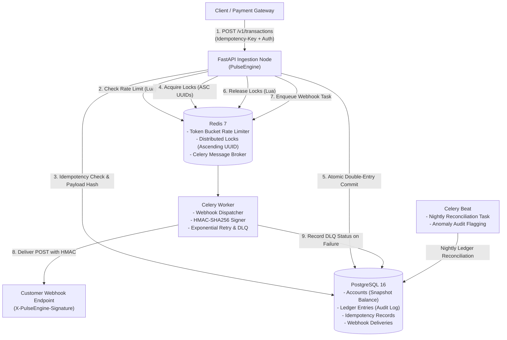
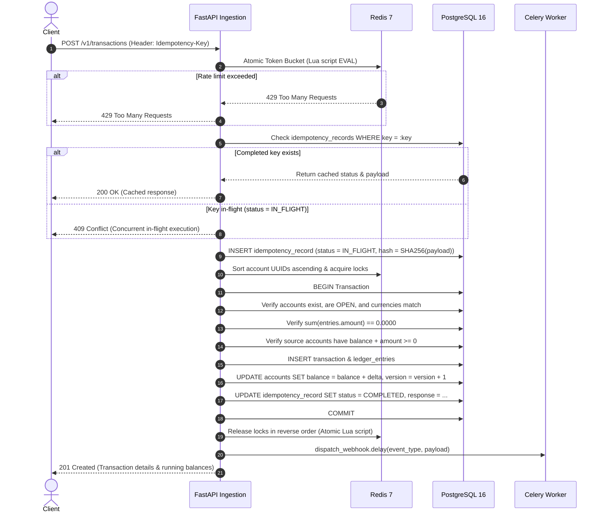

# PulseEngine ⚡

> **High-Throughput Distributed Financial Ledger & Asynchronous Event Ingestion API**  
> Built with Python 3.12+, FastAPI, SQLAlchemy 2.0 (Async), PostgreSQL 16, Redis 7, Celery, and Docker.

[](#testing--verification)
[](#testing--verification)
[](#tech-stack)
[](#distributed-systems-primitives)
[](#license)

---

## 📖 Overview

**PulseEngine** is an enterprise-grade financial ledger engineered to solve the hardest problems in distributed accounting: **concurrency race conditions**, **in-flight duplicate requests**, **cross-account deadlocks**, and **ledger reconciliation drift**.

Unlike traditional relational CRUD applications, PulseEngine enforces strict financial invariants at both the database and distributed layer:
- **Mathematical Zero-Sum Conservation**: Debits and credits across any multi-legged transaction must balance to zero ($\sum \Delta = 0$).
- **No Floating-Point Rounding**: All monetary math uses `NUMERIC(18, 4)` fixed-point arithmetic.
- **Deadlock-Free Locking**: Distributed locking across arbitrary numbers of accounts strictly in ascending UUID order eliminates circular waits.
- **Deterministic DB-Backed Idempotency**: Cryptographic SHA-256 payload verification blocks duplicate processing and enables instant replay.
- **Resilient Webhook Outbox**: Signed HMAC-SHA256 event deliveries with exponential backoff and Dead-Letter Queue (DLQ).
- **Audit-Only Nightly Reconciliation**: Periodic Celery Beat verification that flags snapshot balance discrepancies without silent mutations.

---

## 🏛️ System Architecture



### Transaction Processing Flow



---

## 🛡️ Core Financial & Distributed Primitives

### 1. Double-Entry Bookkeeping Invariant
Every transaction comprises $n \ge 2$ entries. Each entry represents either an asset debit or credit:
$$\sum_{i=1}^{n} \text{amount}_i = 0.0000$$
- Entries are immutable. To correct an error, the `/v1/transactions/{id}/reverse` endpoint posts a balanced mirror reversal transaction.
- Account snapshot balances are enforced by database check constraints: `balance >= 0.0000` (no overdraft).

### 2. Ascending UUID Distributed Locking (Deadlock Freedom)
When multiple concurrent transfers touch common accounts in reverse order (e.g. $A \to B$ and $B \to A$):
- PulseEngine extracts all target account IDs, deduplicates them, and sorts them lexicographically:
  $$\text{Sort}(\{A, B\}) \implies [\min(A, B), \max(A, B)]$$
- By acquiring locks strictly in ascending order, **circular wait (Coffman Condition 4)** is mathematically eliminated.
- Locks are released via an atomic Lua script verifying ownership token equality.

### 3. Database-Backed Idempotency Tracking
Every mutating request requires an `Idempotency-Key` HTTP header:
1. **Hash Verification**: A SHA-256 digest of the request payload is stored. If a caller reuses an existing idempotency key with a mutated payload, PulseEngine rejects it with `422 Unprocessable Content`.
2. **In-Flight Protection**: If two identical requests arrive concurrently, the second encounters an `IN_FLIGHT` record and is rejected with `409 Conflict`.
3. **Replay Caching**: Subsequent requests after completion return the exact original HTTP status and JSON response directly from cache.

### 4. Celery Webhooks & Dead-Letter Queue (DLQ)
- Each delivery computes an **HMAC-SHA256 signature** over the raw JSON payload using the subscriber's secret:
  $$\text{Header: } X\text{-PulseEngine-Signature: } \text{HMAC-SHA256}(secret, payload)$$
- Deliveries execute with exponential backoff: **5 seconds**, **30 seconds**, and **120 seconds**.
- After 3 failed attempts, the record is transitioned to `DLQ` status, enabling operator intervention and replay via `POST /v1/webhooks/deliveries/{id}/redeliver`.

### 5. Nightly Zero-Mutation Reconciliation
A scheduled Celery Beat task runs nightly across all accounts:
- Audits snapshot balances against journal entries:
  $$\text{Audit}(\text{Account}_i) \implies \text{Snapshot}_i \stackrel{?}{=} \sum_{j \in \text{Entries}_i} \text{Amount}_j$$
- Any discrepancy is recorded in `reconciliation_audits` with status `DISCREPANCY` and logged to alerting channels.
- **Strict Rule**: Zero automatic mutations. Ledgers never self-heal; human financial compliance review is required.

---

## 🚀 Quick Start (Docker Compose)

### Prerequisites
- Docker & Docker Compose installed.

### Spin up the Entire Platform
```bash
docker-compose up --build -d
```
This boots 5 containerized services with health checks:
1. `pulseengine_api` (FastAPI web server on port `8000`)
2. `pulseengine_postgres` (PostgreSQL 16 on port `5432`)
3. `pulseengine_redis` (Redis 7 on port `6379`)
4. `pulseengine_celery_worker` (Webhook background dispatcher)
5. `pulseengine_celery_beat` (Nightly reconciliation scheduler)

### Verify System Readiness
```bash
curl -i http://localhost:8000/health/ready
```
Response:
```json
{
  "status": "ready",
  "postgres": "ok",
  "redis": "ok"
}
```

---

## 🔑 Authentication & Rate Limiting

PulseEngine supports dual authentication:
1. **API Key (`X-API-Key`)**: Recommended for service-to-service machine clients. Stored in PostgreSQL as a salted SHA-256 hash.
2. **JWT Bearer Token**: Standard OAuth2 `client_credentials` grant with short-lived access tokens and refresh tokens.

### Generate an API Key
```bash
curl -X POST http://localhost:8000/v1/auth/api-keys \
  -H "Content-Type: application/json" \
  -d '{"name": "Production Service"}'
```
Response:
```json
{
  "id": "019468ab-...",
  "name": "Production Service",
  "api_key": "pk_live_...",
  "created_at": "2026-10-17T12:00:00Z"
}
```

### Redis Token Bucket Rate Limiting
- Every authenticated principal (API key or JWT sub) is metered via an atomic Redis Lua script.
- Configured defaults: **100 tokens capacity**, **10 tokens/sec refill rate**.
- If tokens are exhausted, the server responds with `429 Too Many Requests` and headers indicating remaining balance and reset timing.

---

## 📡 API Reference

### Health & Monitoring
| Method | Endpoint | Description |
|---|---|---|
| `GET` | `/health/live` | Liveness probe (process responsive) |
| `GET` | `/health/ready` | Readiness probe (verifies PostgreSQL & Redis connections) |

### Authentication
| Method | Endpoint | Description |
|---|---|---|
| `POST` | `/v1/auth/api-keys` | Generate new API key (hash stored, plaintext returned once) |
| `POST` | `/v1/auth/clients` | Register OAuth2 client credentials |
| `POST` | `/v1/auth/token` | Obtain JWT access + refresh tokens |
| `POST` | `/v1/auth/token/refresh` | Refresh an expired access token |

### Accounts
| Method | Endpoint | Description |
|---|---|---|
| `POST` | `/v1/accounts` | Create account (UUIDv7, owner, currency, initial balance) |
| `GET` | `/v1/accounts` | List accounts (cursor-based pagination) |
| `GET` | `/v1/accounts/{id}` | Retrieve account details and current balance |
| `DELETE`| `/v1/accounts/{id}` | Soft-delete account closure (`status=CLOSED`) |

### Financial Transactions & Ledger
| Method | Endpoint | Description |
|---|---|---|
| `POST` | `/v1/transactions` | Post multi-legged balanced transaction (requires `Idempotency-Key`) |
| `GET` | `/v1/transactions` | List transactions (cursor-based pagination) |
| `GET` | `/v1/transactions/{id}`| Retrieve transaction details and associated ledger entries |
| `POST` | `/v1/transactions/{id}/reverse` | Post a balanced mirror reversal transaction |
| `GET` | `/v1/accounts/{id}/entries` | Get full immutable ledger audit trail for an account |

### Webhooks
| Method | Endpoint | Description |
|---|---|---|
| `POST` | `/v1/webhooks/subscriptions` | Register webhook endpoint and subscribed event types |
| `GET` | `/v1/webhooks/subscriptions` | List active subscriptions |
| `DELETE`| `/v1/webhooks/subscriptions/{id}` | Deactivate webhook subscription |
| `GET` | `/v1/webhooks/deliveries` | Audit webhook delivery history & status |
| `POST` | `/v1/webhooks/deliveries/{id}/redeliver` | Manually redeliver a failed or DLQ webhook |

---

## ⚡ High-Throughput Load Testing (Locust)

PulseEngine includes an automated Locust stress test in `locustfile.py` designed to benchmark ledger ingestion, lock contention, and replay caching.

### Run Locust Headless (1,000 req/sec benchmark)
```bash
locust -f locustfile.py \
  --headless \
  --users 200 \
  --spawn-rate 50 \
  --run-time 60s \
  --host http://localhost:8000
```

### Run Locust with Interactive Web UI
```bash
locust -f locustfile.py --host http://localhost:8000
```
Then navigate to `http://localhost:8089` to monitor real-time request per second curves, failure rates, and p95 latency percentiles.

---

## 🧪 Testing & Verification

PulseEngine features a comprehensive test suite executed with `pytest`, `pytest-asyncio`, and `fakeredis[lua]`.

```bash
# Run all tests with code coverage report
pytest tests/ --cov=app --cov-report=term-missing
```

### Test Coverage Highlights
- **100% Invariant Validation**: Verifies zero-sum rejection, multi-currency rejection, and negative balance prevention.
- **Race Condition Under Load**: 20 concurrent async workers attempting simultaneous debits on an account with funds for only 10. Exactly 10 succeed, 10 fail with 422, and final balance is strictly `$0.0000`.
- **Bidirectional Deadlock Prevention**: Proves that concurrent transfers $A \to B$ and $B \to A$ complete with zero timeouts or deadlocks.
- **Idempotency Replay**: 10 identical submissions yield 1 DB write and 9 instant cache hits.
- **Webhook DLQ Lifecycle**: Simulates endpoint network outages and verifies exponential retry escalation to Dead-Letter Queue.

---

## 📑 Postmortem & Concurrency Bug Log

For deep engineering details on bugs encountered during development, root cause investigations, and technical interview stories, see:
👉 [**ENGINEERING_INCIDENTS_AND_LEARNINGS.md**](file:///ENGINEERING_INCIDENTS_AND_LEARNINGS.md)

---

## 📄 License
This project is licensed under the MIT License.
